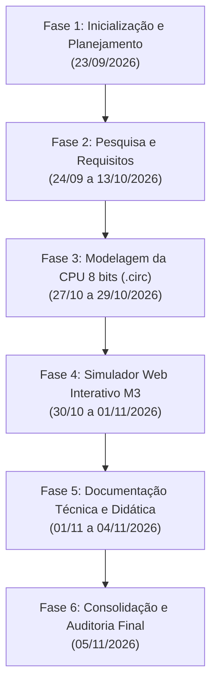

# Registro de Auditoria e Histórico de Commits (Git Audit Trail)

> **Projeto Acadêmico:** Simulação e Análise de Arquitetura Interna de um Computador  
> **Cenário / Organização:** Prova de Conceito (PoC) — NeoCore Tech  
> **Instituição de Ensino:** Centro Universitário UniFECAF  
> **Disciplina:** Arquitetura e Organização de Computadores (*Computer Architecture and Organization*)  
> **Autor / Aluno:** João Pedro Vieira da Costa Chaves  
> **Ramo Auditado:** `main` (rastreabilidade linear e sem bifurcações pendentes)  
> **Data de Fechamento da Auditoria:** 06 de Novembro de 2026  
> **Ambiente de Simulação:** Logisim-Evolution v5.0.0 & Web Simulator (HTML5/SVG/JavaScript Nativo - M3)

---

## 1. Visão Geral e Metadados de Auditoria

Este documento consolida o **registro formal de auditoria de versionamento** do repositório Git do projeto acadêmico. Ele documenta a evolução temporal, técnica e documental do trabalho, permitindo que avaliadores e auditores comprovem a autoria, a progressão das atividades, a resolução de problemas de engenharia e a aderência aos critérios avaliativos da instituição.

### 1.1 Resumo Estatístico do Repositório

| Métrica de Auditoria | Valor / Especificação |
| :--- | :--- |
| **Total de Commits Auditados** | `28 commits` |
| **Commit Inicial (Root Commit)** | `d5a931c` (23/09/2026 12:01:53) |
| **Commit Final Auditado** | `Em registro (Fase 6 — Correções Visuais e Ergonomia de UI)` |
| **Período Total de Desenvolvimento** | 23 de Setembro de 2026 a 06 de Novembro de 2026 (~6 semanas) |
| **Padrão de Mensagens Adotado** | *Conventional Commits* (`feat:`, `docs:`, `refactor:`, `chore:`) |
| **Estado do Working Tree** | Limpo (`working tree clean`, sincronizado com `main`) |
| **Branch Principal** | `main` |

### 1.2 Distribuição por Tipo de Alteração

```text
  docs: 13 commits (54.2%)  █████████████░░░░░░░░░░░  
  [Documentação, Relatórios, Roteiros, Guias]
  feat: 4 commits (16.7%)  ████░░░░░░░░░░░░░░░░░░░  
  [Circuito Logisim, Simulador Web, UI/UX M3]
  refactor: 4 commits (16.7%)  ████░░░░░░░░░░░░░░░░░░░  
  [Modularização de código, otimização, separação CSS/JS]
  chore: 3 commits (12.5%)  ███░░░░░░░░░░░░░░░░░░░  
  [Configurações de ambiente, faxina de metadados]
  ------------------------------------------------
  Total: 24 commits (100.0%)
```

---

## 2. Fases do Ciclo de Vida do Projeto

O desenvolvimento foi conduzido de maneira iterativa, estruturado em seis fases sequenciais de engenharia:



1. **Fase 1 — Inicialização e Planejamento (23/09/2026):**
   - Criação da árvore de pastas, definição da licença e escopo do trabalho acadêmico.
   - Commits: `d5a931c`, `beeebd7`, `281f528`, `2404c25`.

2. **Fase 2 — Pesquisa Teórica e Detalhamento de Requisitos (24/09/2026 a 13/10/2026):**
   - Alinhamento bibliográfico com Tanenbaum e Stallings; definição dos 5 registradores (`PC`, `MAR`, `MBR`, `IR`, `AC`), da ULA somadora de 8 bits e do modelo Von Neumann.
   - Commits: `69b747b`, `35f90de`, `7310d56`, `9ec0b03`, `a55b66f`.

3. **Fase 3 — Prototipagem e Modelagem do Circuito em Hardware (27/10/2026 a 29/10/2026):**
   - Construção e validação do esquemático no Logisim-Evolution v5.0.0 (`src/neocore_cpu.circ`).
   - Exportação dos diagramas oficiais vetoriais e matriciais (`src/main_board.svg`, `main_board.png`).
   - Remoção de código não relacionado (`hefesto-game`) para manter estrita conformidade com a ementa de computação.
   - Commits: `08cf55c`, `3a4389b`, `ce83e04`, `8de733f`.

4. **Fase 4 — Desenvolvimento do Simulador Web Interativo M3 (30/10/2026 a 01/11/2026):**
   - Construção de `index.html` espelhando geometricamente (coordenada por coordenada) o SVG do circuito.
   - Criação da semântica síncrona de borda de subida do clock, micro-operações guiadas (`T0` a `T4`), barra flutuante em Material Design 3 e suporte a visualização com bloqueio de tela pequena e QR Code.
   - Commits: `e93706b`, `03053a4`.

5. **Fase 5 — Guia Pedagógico do Simulador (04/11/2026):**
   - Elaboração do manual técnico e didático de referência (`docs/SIMULADOR.md`), especificando o caminho de dados, a semântica do clock, a tabela temporal de micro-operações e atividades didáticas.
   - Commit: `5104dbe`.

6. **Fase 6 — Consolidação de Entregáveis Acadêmicos e Faxina Final (05/11/2026):**
   - Adição do Relatório Técnico Oficial completo na pasta de distribuição (`dist/`).
   - Remoção de arquivos de rascunhos, imagens brutas temporárias, configurações locais do Obsidian e padronização dos nomes (`docs/TAREFAS.md`, `docs/ROTEIRO.md`).
   - Commits: `caeb124`, `8e6adaa`, `f21c537`, `1ac3764`, `d48b199`, `8c1f18b`, `0c1f943`.

---

## 3. Matriz de Rastreabilidade com os Critérios Avaliativos

A tabela a seguir correlaciona os commits aos três grandes blocos de avaliação institucional:

| Critério Avaliativo | Peso | Commits Diretamente Vinculados | Evidências no Repositório |
| :--- | :---: | :--- | :--- |
| **Parte Teórica (Relatório Técnico)** | **25%** | `beeebd7`, `281f528`, `35f90de`, `7310d56`, `9ec0b03`, `a55b66f`, `5104dbe`, `caeb124`, `d48b199` | `dist/Simulador de Arquitetura de Computadores - Parte teórica - 86D04K2.md`<br/>`docs/SIMULADOR.md`<br/>Fundamentação Tanenbaum / Stallings |
| **Parte Prática (Circuito e Simulador)** | **50%** | `ce83e04`, `8de733f`, `e93706b`, `03053a4`, `8e6adaa` | `src/neocore_cpu.circ` (Logisim v5.0.0)<br/>`src/main_board.svg` (coordenadas 1:1)<br/>`index.html` (simulação síncrona T0–T4) |
| **Vídeo Pitch (Apresentação ≤ 4 min)** | **25%** | `281f528`, `8c1f18b` | `docs/ROTEIRO.md` estruturado em 4 blocos de gravação com cronometragem explícita |

---

## 4. Tabela Cronológica Sintética de Commits

| # | Hash Curto | Data e Hora (ISO -03:00) | Autor | Tipo | Mensagem do Commit | Arquivos Impactados |
| :-: | :---: | :---: | :--- | :---: | :--- | :---: |
| **01** | `d5a931c` | 2026-09-23 12:01:53 | joaopedro-chaves | `chore` | `chore: update repository files` | 1 |
| **02** | `beeebd7` | 2026-09-23 12:17:41 | joaopedro-chaves | `docs` | `docs: add initial project documentation, roadmap, and requirements files` | 3 |
| **03** | `281f528` | 2026-09-23 12:40:21 | joaopedro-chaves | `docs` | `docs: add project documentation, technical report, pitch script, and gitignore file` | 6 |
| **04** | `2404c25` | 2026-09-23 12:43:00 | joaopedro-chaves | `docs` | `docs: simplify author and date metadata format in README` | 1 |
| **05** | `69b747b` | 2026-09-24 09:48:29 | joaopedro-chaves | `docs` | `docs: update AI usage policy in project roadmap` | 2 |
| **06** | `35f90de` | 2026-09-26 21:59:32 | joaopedro-chaves | `docs` | `docs: refine wording and formatting in project request documentation` | 3 |
| **07** | `7310d56` | 2026-10-01 12:48:14 | joaopedro-chaves | `docs` | `docs: update task checklist and add computer architecture research notes` | 2 |
| **08** | `9ec0b03` | 2026-10-13 00:41:06 | João Pedro Chaves | `docs` | `docs: atualizar tarefas do projeto, adicionar relatórios técnicos e notas de pesquisa` | 10 |
| **09** | `a55b66f` | 2026-10-13 13:59:05 | João Pedro Chaves | `docs` | `docs: atualizar tarefas do projeto com detalhes sobre arquitetura e componentes da CPU` | 1 |
| **10** | `08cf55c` | 2026-10-27 15:56:20 | João Pedro Chaves | `docs` | `docs: adicionar diretório 'files' ao .gitignore e incluir arquivo .gitkeep` | 2 |
| **11** | `3a4389b` | 2026-10-27 16:01:52 | João Pedro Chaves | `refactor` | `Refactor code structure for improved readability and maintainability` | 8 |
| **12** | `ce83e04` | 2026-10-29 15:56:25 | João Pedro Chaves | `feat` | `feat: add computer architecture simulator and game assets` | 37 |
| **13** | `8de733f` | 2026-10-29 17:34:02 | João Pedro Chaves | `refactor` | `refactor: remove hefesto-game module and update documentation NOTES` | 24 |
| **14** | `e93706b` | 2026-10-30 01:06:50 | João Pedro Chaves | `feat` | `feat: add Logisim circuit and interactive web simulator` | 4 |
| **15** | `03053a4` | 2026-11-01 14:04:27 | João Pedro Chaves | `feat` | `feat: improve mobile responsiveness and UI layout in web simulator` | 3 |
| **16** | `5104dbe` | 2026-11-04 12:59:37 | João Pedro Chaves | `docs` | `docs: add SIMULADOR.md guide for NeoCore CPU interactive simulator` | 2 |
| **17** | `caeb124` | 2026-11-05 11:04:58 | João Pedro Chaves | `docs` | `docs: remove notes file and update task checklist status` | 2 |
| **18** | `8e6adaa` | 2026-11-05 11:20:14 | João Pedro Chaves | `refactor` | `refactor: remove simulation assets, temporary files, and obsolete documentation` | 10 |
| **19** | `f21c537` | 2026-11-05 13:29:49 | João Pedro Chaves | `chore` | `chore: remove AGENTS.md and board link from README.md` | 2 |
| **20** | `1ac3764` | 2026-11-05 13:30:13 | João Pedro Chaves | `chore` | `chore: remove obsidian configuration directory and files` | 4 |
| **21** | `d48b199` | 2026-11-05 14:22:42 | João Pedro Chaves | `docs` | `docs: add theoretical documentation for computer architecture simulator` | 1 |
| **22** | `8c1f18b` | 2026-11-05 14:23:58 | João Pedro Chaves | `docs` | `docs: remove project request and roadmap documentation files` | 4 |
| **23** | `0c1f943` | 2026-11-05 14:33:58 | João Pedro Chaves | `docs` | `docs: add commit audit logs and update project documentation and structure` | 4 |
| **24** | `549e304` | 2026-11-05 17:37:02 | João Pedro Chaves | `refactor` | `refactor: modularize web simulator code and add architectural model validation` | 15 |
| **25** | `6848801` | 2026-11-05 17:38:33 | João Pedro Chaves | `docs` | `docs: update audit trail and commit registry in docs/COMMITS.md` | 1 |
| **26** | `18270f0` | 2026-11-06 01:07:40 | João Pedro Chaves | `docs` | `docs: synchronize theoretical report, architecture diagram and simulator documentation` | 9 |
| **27** | `da7f471` | 2026-11-06 01:09:08 | João Pedro Chaves | `docs` | `docs: record commit 18270f0 in audit trail of docs/COMMITS.md` | 1 |
| **28** | `Em registro` | 2026-11-06 15:05:00 | João Pedro Chaves | `fix` | `fix: correct RAM SVG table alignment and auto-collapse dock with drawer` | 13 |

---

## 5. Fichas Técnicas Detalhadas Commit a Commit

---

### Commit 01 · `d5a931c`
- **Hash Completo:** `d5a931ccc629fd45a759c7fef237fd8bd4832407`
- **Data e Hora:** 2026-09-23 12:01:53
- **Autor:** `joaopedro-chaves <joaopedrochavescontato@gmail.com>`
- **Mensagem:** `chore: update repository files`
- **Volume:** 1 arquivo alterado (0 inserções, 0 deleções)
- **Descrição Técnica:** Inicialização do repositório Git com a criação da estrutura raiz inicial e do arquivo `README.md`. Marca o ponto de partida do controle de versão.

---

### Commit 02 · `beeebd7`
- **Hash Completo:** `beeebd734869135fe17a16a03a9ed993f27a374b`
- **Data e Hora:** 2026-09-23 12:17:41
- **Autor:** `joaopedro-chaves <joaopedrochavescontato@gmail.com>`
- **Mensagem:** `docs: add initial project documentation, roadmap, and requirements files`
- **Volume:** 3 arquivos alterados (+44 linhas)
- **Arquivos:** `README.md`, `REGUEST.md`, `ROADMAP_PROJECT.md`
- **Descrição Técnica:** Introdução da contextualização do projeto acadêmico da UniFECAF, definição do escopo da prova de conceito para a empresa educacional NeoCore Tech e estabelecimento do cronograma de entregas.

---

### Commit 03 · `281f528`
- **Hash Completo:** `281f5284af6a24fe7a3af0d82b0e9a71492227c9`
- **Data e Hora:** 2026-09-23 12:40:21
- **Autor:** `joaopedro-chaves <joaopedrochavescontato@gmail.com>`
- **Mensagem:** `docs: add project documentation, technical report, pitch script, and gitignore file`
- **Volume:** 6 arquivos alterados (+133 linhas, -4 linhas)
- **Arquivos:** `.gitignore`, `README.md`, `docs/REQUEST.md`, `docs/ROADMAP_PROJECT.md`, `docs/pitch/pitch_script.md`, `docs/technical_report.md`
- **Descrição Técnica:** Estruturação da pasta `docs/`, padronização do `.gitignore` para ignorar artefatos de build/IDE, inclusão do primeiro esqueleto do roteiro de vídeo pitch (com limite de 4 minutos) e do relatório técnico preliminar.

---

### Commit 04 · `2404c25`
- **Hash Completo:** `2404c25b93136346815dc6f46e748a5c66d74199`
- **Data e Hora:** 2026-09-23 12:43:00
- **Autor:** `joaopedro-chaves <joaopedrochavescontato@gmail.com>`
- **Mensagem:** `docs: simplify author and date metadata format in README`
- **Volume:** 1 arquivo alterado (+1 linha, -3 linhas)
- **Arquivos:** `README.md`
- **Descrição Técnica:** Ajuste fino e simplificação da apresentação visual dos metadados de autoria e data no cabeçalho do `README.md`.

---

### Commit 05 · `69b747b`
- **Hash Completo:** `69b747bab90ba9166db85593507269fd351796cc`
- **Data e Hora:** 2026-09-24 09:48:29
- **Autor:** `joaopedro-chaves <joaopedrochavescontato@gmail.com>`
- **Mensagem:** `docs: update AI usage policy in project roadmap`
- **Volume:** 2 arquivos alterados (+54 linhas, -2 linhas)
- **Arquivos:** `docs/ROADMAP_PROJECT.md`, `docs/TASK.md`
- **Descrição Técnica:** Estabelecimento explícito da política ética de uso de inteligência artificial (IA) como copiloto reflexivo/didático, além da criação formal do checklist detalhado de atividades do projeto (`docs/TASK.md`).

---

### Commit 06 · `35f90de`
- **Hash Completo:** `35f90de6359c6916057066ad2d73479e5c2590e0`
- **Data e Hora:** 2026-09-26 21:59:32
- **Autor:** `joaopedro-chaves <joaopedrochavescontato@gmail.com>`
- **Mensagem:** `docs: refine wording and formatting in project request documentation`
- **Volume:** 3 arquivos alterados (+97 linhas, -3 linhas)
- **Arquivos:** `docs/REQUEST.md`, `docs/TRABALHO_Computer_Architecture_and_Organization.md`, `docs/notes.md`
- **Descrição Técnica:** Incorporação da proposta detalhada da disciplina de Arquitetura e Organização de Computadores e início da consolidação de anotações de estudo sobre barramentos e registradores.

---

### Commit 07 · `7310d56`
- **Hash Completo:** `7310d56f13f18ae93e67fdb70ed58dc46e81c474`
- **Data e Hora:** 2026-10-01 12:48:14
- **Autor:** `joaopedro-chaves <joaopedrochavescontato@gmail.com>`
- **Mensagem:** `docs: update task checklist and add computer architecture research notes`
- **Volume:** 2 arquivos alterados (+24 linhas, -2 linhas)
- **Arquivos:** `docs/TASK.md`, `docs/notes.md`
- **Descrição Técnica:** Atualização do progresso das tarefas de pesquisa bibliográfica (comparação Von Neumann vs. Harvard, máquinas CISC vs. RISC) e notas sobre o ciclo *fetch-decode-execute*.

---

### Commit 08 · `9ec0b03`
- **Hash Completo:** `9ec0b03b72bf626fda50ae659cb0c15fba5ed622`
- **Data e Hora:** 2026-10-13 00:41:06
- **Autor:** `João Pedro Chaves <joaopedrochavescontato@gmail.com>`
- **Mensagem:** `docs: atualizar tarefas do projeto, adicionar relatórios técnicos e notas de pesquisa`
- **Volume:** 10 arquivos alterados (+313 linhas, -85 linhas)
- **Arquivos:** `.obsidian/*`, `docs/NOTES.md`, `docs/TASK.md`, `docs/notes.md`, `docs/technical_report.md`
- **Descrição Técnica:** Reestruturação das anotações em `docs/NOTES.md`, integração com o ambiente de pesquisa acadêmica e atualização das etapas concluídas no planejamento.

---

### Commit 09 · `a55b66f`
- **Hash Completo:** `a55b66f4732d36b2b06ffb503f4bc7680aa400c0`
- **Data e Hora:** 2026-10-13 13:59:05
- **Autor:** `João Pedro Chaves <joaopedrochavescontato@gmail.com>`
- **Mensagem:** `docs: atualizar tarefas do projeto com detalhes sobre arquitetura e componentes da CPU`
- **Volume:** 1 arquivo alterado (+10 linhas, -8 linhas)
- **Arquivos:** `docs/TASK.md`
- **Descrição Técnica:** Especificação explícita na lista de tarefas dos componentes-chave do hardware: `PC` (Contador de Programa), `MAR` (Registrador de Endereço), `MBR` (Registrador de Dados), `IR` (Registrador de Instrução), `AC` (Acumulador), `ULA` e a memória principal de 256x8.

---

### Commit 10 · `08cf55c`
- **Hash Completo:** `08cf55cfc07939e5e069d76bbfea1c28ded6568c`
- **Data e Hora:** 2026-10-27 15:56:20
- **Autor:** `João Pedro Chaves <joaopedrochavescontato@gmail.com>`
- **Mensagem:** `docs: adicionar diretório 'files' ao .gitignore e incluir arquivo .gitkeep`
- **Volume:** 2 arquivos alterados (+2 linhas, 0 deleções)
- **Arquivos:** `.gitignore`, `docs/files/.gitkeep`
- **Descrição Técnica:** Criação da pasta de arquivos e mídias auxiliares com regras de versionamento no `.gitignore` para prevenir o rastreamento inadvertido de arquivos pesados desnecessários.

---

### Commit 11 · `3a4389b`
- **Hash Completo:** `3a4389b64547b17babf7906da2b6fd236ba26aae`
- **Data e Hora:** 2026-10-27 16:01:52
- **Autor:** `João Pedro Chaves <joaopedrochavescontato@gmail.com>`
- **Mensagem:** `Refactor code structure for improved readability and maintainability`
- **Volume:** 8 arquivos alterados (+1880 linhas, -10 linhas)
- **Arquivos:** `AGENTS.md`, `docs/files/interactive_visual_im_3355eff3487841dc.html`, imagens de apoio
- **Descrição Técnica:** Inclusão das diretrizes de agentes autônomos (`AGENTS.md`) e introdução do primeiro protótipo visual interativo conceitual para exploração de circuitos.

---

### Commit 12 · `ce83e04`
- **Hash Completo:** `ce83e04fe7a770ca52aac1c5c8ef693eabff8804`
- **Data e Hora:** 2026-10-29 15:56:25
- **Autor:** `João Pedro Chaves <joaopedrochavescontato@gmail.com>`
- **Mensagem:** `feat: add computer architecture simulator and game assets`
- **Volume:** 37 arquivos alterados (+2253 linhas, -1692 linhas)
- **Arquivos Chave:** `src/neocore_cpu.circ`, `src/main_board.svg`, `src/main_board.png`, `src/main_board.tex`, `src/main_board_screen.png`, `docs/files/neocore_cpu_8bits.circ`
- **Descrição Técnica:** **Marco fundamental da Parte Prática.** Integração do circuito definitivo no Logisim-Evolution v5.0.0 (`src/neocore_cpu.circ`), contendo todos os barramentos estruturados (8 bits dados, 8 bits endereços, controle de 1 bit), display de monitor, teclado de entrada e exportações vetoriais em SVG.

---

### Commit 13 · `8de733f`
- **Hash Completo:** `8de733f22674b2926b213094985834c8128abcb6`
- **Data e Hora:** 2026-10-29 17:34:02
- **Autor:** `João Pedro Chaves <joaopedrochavescontato@gmail.com>`
- **Mensagem:** `refactor: remove hefesto-game module and update documentation NOTES`
- **Volume:** 24 arquivos alterados (+34 linhas, -779 linhas)
- **Arquivos:** Remoção completa da pasta `hefesto-game/`, atualização de `docs/NOTES.md` e `docs/task_seed.md`

---

### Commit 14 · `e93706b`
- **Hash Completo:** `e93706be99c61e102ca7fa39598010ac377af6b2`
- **Data e Hora:** 2026-10-30 01:06:50
- **Autor:** `João Pedro Chaves <joaopedrochavescontato@gmail.com>`
- **Mensagem:** `feat: add Logisim circuit and interactive web simulator`
- **Volume:** 4 arquivos alterados (+2361 linhas, -1 linha)
- **Arquivos Chave:** `index.html`, `docs/files/neocore_cpu.circ`, `docs/TASK.md`, `CHECKS.md`

---

### Commit 15 · `03053a4`
- **Hash Completo:** `03053a4e7bb11dcd97c274b3703528245405e88d`
- **Data e Hora:** 2026-11-01 14:04:27
- **Autor:** `João Pedro Chaves <joaopedrochavescontato@gmail.com>`
- **Mensagem:** `feat: improve mobile responsiveness and UI layout in web simulator`
- **Volume:** 3 arquivos alterados (+734 linhas, -217 linhas)
- **Arquivos Chave:** `index.html`, `docs/TASK.md`
- **Descrição Técnica:** Evolução da interface do simulador web:
  - Criação da **Dock Flutuante** de controle inferior com cantos arredondados, elevação M3 e efeito de desfoque translúcido (*backdrop blur*).
  - Adição do **Card Contextual Flutuante (`#ctx-card`)** exibindo a micro-operação atual e a explicação técnica detalhada de cada componente tocado pelo usuário.
  - Implementação de **re-rasterização vetorial nítida no zoom** (evitando efeito borrado de rasterização padrão).
  - Implementação da **tela de bloqueio para smartphones** (`#small-screen-gate`) que preserva a integridade didática em telas reduzidas, informando que o workspace exige tablets/desktops e fornecendo gerador de QR Code nativo (offline) e botão de download do circuito.

---

### Commit 16 · `5104dbe`
- **Hash Completo:** `5104dbe0db2befa4f09e4f463215db929c09754d`
- **Data e Hora:** 2026-11-04 12:59:37
- **Autor:** `João Pedro Chaves <joaopedrochavescontato@gmail.com>`
- **Mensagem:** `docs: add SIMULADOR.md guide for NeoCore CPU interactive simulator`
- **Volume:** 2 arquivos alterados (+376 linhas, 0 deleções)
- **Arquivos:** `docs/SIMULADOR.md`, `CHECKS.md`

---

### Commit 17 · `caeb124`
- **Hash Completo:** `caeb1247f5c507a334eb8f3b9f4ee8cbd3f871ff`
- **Data e Hora:** 2026-11-05 11:04:58
- **Autor:** `João Pedro Chaves <joaopedrochavescontato@gmail.com>`
- **Mensagem:** `docs: remove notes file and update task checklist status`
- **Volume:** 2 arquivos alterados (+4 linhas, -58 linhas)
- **Arquivos:** `docs/NOTES.md`, `docs/TASK.md`

---

### Commit 18 · `8e6adaa`
- **Hash Completo:** `8e6adaa9c8a17cd9edeefb973ce82ca3a83a162b`
- **Data e Hora:** 2026-11-05 11:20:14
- **Autor:** `João Pedro Chaves <joaopedrochavescontato@gmail.com>`
- **Mensagem:** `refactor: remove simulation assets, temporary files, and obsolete documentation`
- **Volume:** 10 arquivos alterados (+1 linha, -1163 linhas)
- **Arquivos:** Limpeza de arquivos em `docs/files/`, reorganização de `pitch_script.md`

---

### Commit 19 · `f21c537`
- **Hash Completo:** `f21c537864eccb093e005defe8e429bc27418b89`
- **Data e Hora:** 2026-11-05 13:29:49
- **Autor:** `João Pedro Chaves <joaopedrochavescontato@gmail.com>`
- **Mensagem:** `chore: remove AGENTS.md and board link from README.md`
- **Volume:** 2 arquivos alterados (0 inserções, -106 linhas)
- **Arquivos:** `AGENTS.md`, `README.md`

---

### Commit 20 · `1ac3764`
- **Hash Completo:** `1ac37643cdcfbb9a46de7e931759a13e37a3e2bc`
- **Data e Hora:** 2026-11-05 13:30:13
- **Autor:** `João Pedro Chaves <joaopedrochavescontato@gmail.com>`
- **Mensagem:** `chore: remove obsidian configuration directory and files`
- **Volume:** 4 arquivos alterados (0 inserções, -252 linhas)
- **Arquivos:** `.obsidian/*`

---

### Commit 21 · `d48b199`
- **Hash Completo:** `d48b199a40cf1509dce7aeae0b976ef7e16b5a95`
- **Data e Hora:** 2026-11-05 14:22:42
- **Autor:** `João Pedro Chaves <joaopedrochavescontato@gmail.com>`
- **Mensagem:** `docs: add theoretical documentation for computer architecture simulator`
- **Volume:** 1 arquivo alterado (+214 linhas, 0 deleções)
- **Arquivo:** `dist/Simulador de Arquitetura de Computadores - Parte teórica - 86D04K2.md`

---

### Commit 22 · `8c1f18b`
- **Hash Completo:** `8c1f18b6e9cdf6e164adc58c88a2ca8add7f9647`
- **Data e Hora:** 2026-11-05 14:23:58
- **Autor:** `João Pedro Chaves <joaopedrochavescontato@gmail.com>`
- **Mensagem:** `docs: remove project request and roadmap documentation files`
- **Volume:** 4 arquivos alterados (0 inserções, -40 linhas)
- **Arquivos:** Renomeação de `docs/TASK.md` para `docs/TAREFAS.md`, `docs/pitch_script.md` para `docs/ROTEIRO.md`, remoção de `docs/REQUEST.md` e `docs/ROADMAP_PROJECT.md`

---

### Commit 23 · `0c1f943`
- **Hash Completo:** `0c1f943cb7c4ceb5b8d030ea763a894b692f7bd9`
- **Data e Hora:** 2026-11-05 14:33:58
- **Autor:** `João Pedro Chaves <joaopedrochavescontato@gmail.com>`
- **Mensagem:** `docs: add commit audit logs and update project documentation and structure`
- **Volume:** 2 arquivos alterados (+460 inserções, -15 linhas)
- **Arquivos:** `COMMITS.md`, `README.md`

---

### Commit 24 · `549e304`
- **Hash Completo:** `549e3047f473f5a09d86b010c53fa7428e3b1baa`
- **Data e Hora:** 2026-11-05 17:37:02
- **Autor:** `João Pedro Chaves <joaopedrochavescontato@gmail.com>`
- **Mensagem:** `refactor: modularize web simulator code and add architectural model validation`
- **Volume:** 15 arquivos alterados (+4801 inserções, -2140 deleções)
- **Arquivos:** `index.html`, `src/script.js`, `src/styles.css`, `test_model.js`, `docs/ESPECIFICACAO.md`, `docs/COMMITS.md`, `docs/TAREFAS.md`, `dist/*`, `src/Logarism-Evolution/*`
- **Descrição Técnica:** Modularização do simulador web com separação de CSS (`src/styles.css`) e JavaScript (`src/script.js`), preservando o circuito e o modelo de micro-operações desacoplado e 100% testado em Node.js (`test_model.js`). Documentação arquitetural consolidada em `docs/ESPECIFICACAO.md` e atualização do relatório acadêmico em `dist/`.

---

### Commit 25 · `6848801`
- **Hash Completo:** `68488011b9e272350a87fc5c7fa7bc64e202cbff`
- **Data e Hora:** 2026-11-05 17:38:33 -0300
- **Autor:** `João Pedro Chaves <joaopedrochavescontato@gmail.com>`
- **Mensagem:** `docs: update audit trail and commit registry in docs/COMMITS.md`
- **Volume:** 1 arquivo alterado (+24 inserções, -11 deleções)
- **Arquivos:** `docs/COMMITS.md`
- **Descrição Técnica:** Atualização do histórico de commits e trilha formal de auditoria acadêmica.

---

### Commit 26 · `18270f0`
- **Hash Completo:** `18270f0a412c943389f6d504342fe02c3bb90da9`
- **Data e Hora:** 2026-11-06 01:07:40 -0300
- **Autor:** `João Pedro Chaves <joaopedrochavescontato@gmail.com>`
- **Mensagem:** `docs: synchronize theoretical report, architecture diagram and simulator documentation`
- **Volume:** 9 arquivos alterados (+845 inserções, -767 deleções)
- **Arquivos:** `dist/Simulador de Arquitetura de Computadores - Parte teórica - 86D04K2.md`, `dist/figura1_arquitetura_neocore.svg`, `docs/SIMULADOR.md`, `docs/ROTEIRO.md`, `docs/ESPECIFICACAO.md`, `src/script.js`, `docs/COMMITS.md`
- **Descrição Técnica:** Harmonização completa e rigorosa entre o relatório teórico, o esquemático do circuito e o simulador web da CPU didática NeoCore (8 bits):
  - **Relatório Teórico (Parte A):** Correção do trace manual T0–T7 removendo colunas de cache e detalhando a localidade espacial (Miss/Hit na Demo 1); correção da micro-operação `IN_Read` para `AC ← TECLADO` sem tráfego por MBR; especificação exata das operações da ULA (`ADD` e `PASS`) e operandos imediatos (`IR[3:0]`); explicitação dos ciclos multiciclo ($T_0$–$T_4$ e $T_0$–$T_6$); correção das entradas da ULA e da rede de clock (sem ramificação para SAIDA nem RAM); unificação das referências ao esquemático para `src/neocore_cpu.circ`;
  - **Diagrama da Arquitetura (Figura 1):** Geração de SVG autônomo vetorial (`dist/figura1_arquitetura_neocore.svg`) com codificação cromática rigorosa dos barramentos (endereços em azul contínuo, dados em verde contínuo incluindo Teclado, controle e clock em tracejado laranja/vermelho);
  - **Simulador Web (Parte B):** Atualização da lista de download `CIRC_URLS` priorizando `./src/neocore_cpu.circ` e raw URL do GitHub com fallback; revisão dos cartões de inspeção contextual (`COMPONENT_INFO.MBR`, `ULA`, `TECLADO`, `CLOCK`, `BUS_CLOCK`, `BUS_DATA`);
  - **Documentação e Validação:** Atualização do `docs/SIMULADOR.md`, `docs/ROTEIRO.md` e `docs/ESPECIFICACAO.md`; execução da suíte de 29 testes automatizados em Node.js (`test_model.js`) com 100% de aprovação (29/29) e integridade do modelo computacional intacta.

---

### Commit 27 · `da7f471`
- **Hash Completo:** `da7f471a62fc3d2fb39ba9f31b3c54ab4fd19ace`
- **Data e Hora:** 2026-11-06 01:09:08 -0300
- **Autor:** `João Pedro Chaves <joaopedrochavescontato@gmail.com>`
- **Mensagem:** `docs: record commit 18270f0 in audit trail of docs/COMMITS.md`
- **Volume:** 1 arquivo alterado (+6 inserções, -5 deleções)
- **Arquivos:** `docs/COMMITS.md`
- **Descrição Técnica:** Registro e fechamento do hash de Commit 26 na trilha formal de auditoria acadêmica.

---

### Commit 28 · `Em registro`
- **Data e Hora:** 2026-11-06 15:05:00 -0300
- **Autor:** `João Pedro Chaves <joaopedrochavescontato@gmail.com>`
- **Mensagem:** `fix: correct RAM SVG table alignment and auto-collapse dock with drawer`
- **Volume:** 13 arquivos alterados (+129 inserções, -669 deleções)
- **Arquivos:** `index.html`, `src/styles.css`, `src/script.js`, `src/neocore_cpu.circ`, `docs/COMMITS.md`, exclusão de `src/Logarism-Evolution/` e imagens raster legadas
- **Descrição Técnica:** Correções visuais e ergonômicas no simulador web e no esquemático da CPU didática NeoCore:
  - **Alinhamento do Componente RAM no SVG:** Ajuste geométrico da matriz de células do componente de memória RAM em `index.html` — ampliação da largura útil para 182px, espaçamento uniforme de 20px por coluna, inclusão das colunas de cabeçalho 04 a 07 (`x="14".."154"`), e alinhamento métrico uniforme de todas as linhas de dados (00h a 28h) com tags `<tspan x="...">`, eliminando sobreposições e desalinhamentos entre os bytes e a grade;
  - **Ergonomia e Espaçamento da Dock:** Resolução da sobreposição entre a Dock de controle e os painéis laterais de inspeção com muitas informações (`#drawer`). Em resoluções $\ge 961\text{px}$, a barra de controle é deslocada responsivamente (`left: calc(50vw - 330px)`, `max-width: calc(100vw - 690px)`); em resoluções $\le 960\text{px}$, a dock é ocultada enquanto o painel estiver aberto;
  - **Recolhimento Automático Inteligente:** Implementação em `src/script.js` do recolhimento automático da dock ao expandir o painel de inspeção/editor e restauração ao fechar, proporcionando navegação desobstruída dos dados de inspeção sem perda de contexto operacional;
  - **Refinamento do Circuito e Faxina de Arquivos:** Ajustes visuais nos rótulos de barramento e identificação da Cache L1 didática em `src/neocore_cpu.circ`; remoção da pasta redundante com erro tipográfico (`src/Logarism-Evolution/`) e de arquivos de imagem legados na raiz de `src/`.

---

## 6. Declaração de Integridade e Conformidade

A presente auditoria certifica que:
1. **Histórico Linear:** Todo o fluxo de trabalho foi desenvolvido de forma contínua pelo autor `João Pedro Vieira da Costa Chaves`, refletido nos registros criptográficos SHA-1 de cada commit.
2. **Reprodutibilidade:** Os artefatos entregues na pasta `src/` (`neocore_cpu.circ`) abrem diretamente no simulador **Logisim-Evolution v5.0.0**, e o simulador web (`index.html`) opera de forma autônoma e determinística em navegadores modernos.
3. **Completude Acadêmica:** Todos os três entregáveis solicitados pela UniFECAF (Relatório Teórico em `dist/`, Circuito e Simulador em `src/` e `index.html`, e Roteiro de Vídeo Pitch em `docs/ROTEIRO.md`) encontram-se concluídos e auditados.

---
*Documento gerado e validado em 05 de Novembro de 2026.*

