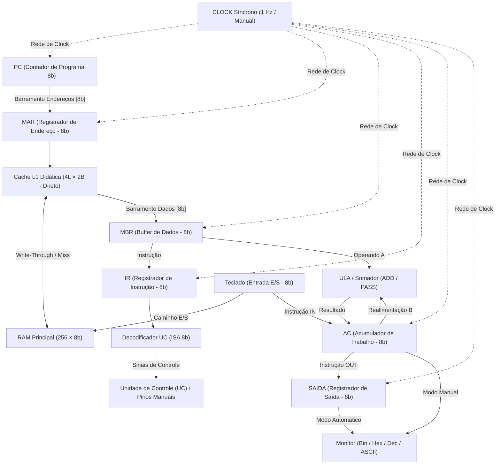
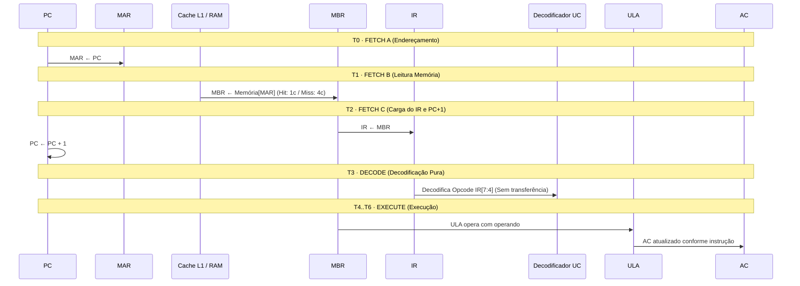

# Simulador Interativo da CPU NeoCore (8 bits)
## 1. Visão geral do projeto

O projeto responde à pergunta norteadora da disciplina:

> *Como os diferentes componentes de um computador trabalham de forma coordenada para buscar, interpretar e executar uma instrução?*

Para isso, foi modelada no **Logisim-Evolution v5.0.0** uma CPU didática de 8 bits baseada na **arquitetura de Von Neumann**, em que instruções e dados compartilham a mesma memória principal física (`RAM 256 × 8`). 

Sobre esse circuito foi construído um **simulador web interativo** de alta fidelidade técnica e visual, com modularização limpa em [`index.html`](../index.html), [`src/styles.css`](../src/styles.css) e [`src/script.js`](../src/script.js), permitindo executar a simulação diretamente em qualquer navegador moderno sem necessidade de ferramentas de compilação ou instalação local do Logisim.

| Entregável | Peso | Localização no Repositório |
| :--- | :---: | :--- |
| **Parte Teórica (Relatório ABNT)** | 25% | [`dist/`](../dist/) e [`docs/`](./) |
| **Parte Prática (Circuito e Simulador Web)** | 50% | [`src/neocore_cpu.circ`](../src/neocore_cpu.circ), [`index.html`](../index.html) e [`src/`](../src/) |
| **Vídeo Pitch (≤ 4 min)** | 25% | [`docs/ROTEIRO.md`](./ROTEIRO.md) |

---

## 2. O que é o simulador interativo

O simulador web é uma aplicação rica e interativa desenvolvida com padrões modernos de desenvolvimento web e diretrizes de design **Material Design 3 (Dark Theme)**. Ele integra:

- **Esquemático vetorial (SVG nativo 1:1):** reprodução em escala vetorial exata do circuito `main_board` do Logisim-Evolution (`1151 × 441` unidades com grade pontilhada e linhas ortogonais).
- **Modelo computacional desacoplado (`/* MODEL:START */` .. `/* MODEL:END */`):** motor lógico síncrono puro em JavaScript, sem dependência do DOM, permitindo testes unitários e de integração em ambientes headless (Node.js via [`test_model.js`](../test_model.js)).
- **Dois modos de operação complementares:**
  - **Modo Manual:** fidelidade 1:1 à bancada do circuito `.circ`, onde o aluno atua como a Unidade de Controle comutando pinos de controle e gerando pulsos de clock.
  - **Modo Automático:** simulação de ciclo temporal completo com Unidade de Controle baseada em autômato de estados ($T_0$ a $T_6$), decodificação de instruções (ISA), hierarquia de memória cache L1 e parada por instrução `HLT`.
- **Painel em tempo real de sinais de controle:** bloco integrado ao canvas SVG com 12 LEDs de status e decodificação contínua.
- **Cache L1 didática (mapeamento direto):** 4 linhas × 2 bytes com rastreamento de hits, misses e latência acumulada de ciclos.
- **Inspetor de memória RAM de 256 bytes:** paginação hexadecimal em blocos de 16 bytes (`00h` a `FFh`) com campo de busca/salto e janela deslizante de 4 bytes sincronizada no esquemático SVG.

---

## 3. Arquitetura modelada e modos de operação

### 3.1 Diagrama do caminho de dados e controle



### 3.2 Modos de operação didáticos

```text
┌───────────────────────────────────┬───────────────────────────────────┐
│           MODO MANUAL             │          MODO AUTOMÁTICO          │
├───────────────────────────────────┼───────────────────────────────────┤
│ • Fiel ao arquivo neocore_cpu.circ│ • UC automática com tabela FSM    │
│ • Estudante atua como a UC        │ • Decodificação de Opcode IR[7:4] │
│ • Acionamento manual de pinos     │ • Estados T0 a T6 automáticos     │
│ • T2 pertence à fase FETCH        │ • T3 executa fase DECODE pura     │
│ • Monitor reflete o Acumulador AC │ • Monitor reflete o reg. SAIDA    │
│ • Decodificação humana ativa      │ • Suporte a Cache L1 e HLT        │
└───────────────────────────────────┴───────────────────────────────────┘
```

---

## 4. Conjunto de instruções (ISA 8-bit)

No Modo Automático, a CPU implementa um conjunto de instruções com formato unificado de 8 bits:
- **Nibble Superior `IR[7:4]`**: Código de Operação (*Opcode* — 4 bits).
- **Nibble Inferior `IR[3:0]`**: Operando imediato ($n$) ou endereço direto de memória ($addr$).

| Opcode | Mnemônico | Operando | RTL (*Register Transfer Language*) | Ciclos ($T$) | Descrição Funcional |
| :---: | :---: | :---: | :--- | :---: | :--- |
| `0x0` | **ADDI** | $n$ | `AC ← AC + n` | 5 | Soma imediata: adiciona valor de 0 a 15 ao Acumulador. |
| `0x1` | **LDI** | $n$ | `AC ← n` | 5 | Carga imediata: carrega valor imediato diretamente no AC. |
| `0x2` | **LDA** | $addr$ | `AC ← RAM[addr]` | 7 | Carga direta: lê byte da RAM (00h–0Fh) para o AC. |
| `0x3` | **ADD** | $addr$ | `AC ← AC + RAM[addr]` | 7 | Soma com memória: soma operando da RAM ao AC. |
| `0x4` | **STA** | $addr$ | `RAM[addr] ← AC` | 7 | Armazenamento: grava o valor do AC na RAM (Write-Through). |
| `0x5` | **OUT** | — | `SAIDA ← AC` | 5 | Saída de dados: envia o valor do AC ao registrador de saída. |
| `0x6` | **IN** | — | `AC ← TECLADO` | 5 | Entrada de dados: lê o byte do Teclado para o AC. |
| `0xF` | **HLT** | — | `HALT ← 1` | 5 | Parada da máquina: cessa a geração de pulsos de clock. |
| *Outro*| **NOP** | — | *(nenhuma)* | 5 | Operação nula / não reconhecida: avança o contador PC. |

---

## 5. Elementos do circuito e subsistemas

### 5.1 Registradores

| Registrador | Bits | Função no Circuito | Sinal de Controle |
| :--- | :---: | :--- | :--- |
| **PC** (*Program Counter*) | 8 | Aponta o endereço da próxima instrução; incrementa sequencialmente. | `PC_Inc` |
| **MAR** (*Memory Address Register*) | 8 | Mantém o endereço apresentado ao barramento de endereços da memória. | `MAR_Load` |
| **MBR** (*Memory Buffer Register*) | 8 | Buffer bidirecional entre o barramento de dados e os blocos internos. | `RAM_Read_MBR` / `MBR_Load` |
| **IR** (*Instruction Register*) | 8 | Retém a instrução buscada para decodificação pela UC. | `IR_Load` |
| **AC** (*Acumulador*) | 8 | Registrador principal de trabalho aritmético da ULA. | `AC_Exec` / `AC_Load` |
| **SAIDA** | 8 | Desacopla o Acumulador do display externo (instrução `OUT`). | `SAIDA_Load` |

### 5.2 Unidades funcionais e E/S

- **ULA (Unidade Lógica e Aritmética):** executa adição de 8 bits (`ADD`: $A + B$) com realimentação do AC, ou transferência direta (`PASS`: $A$).
- **RAM Principal (256 × 8):** endereçamento linear de 8 bits (`00h` a `FFh`). As 4 primeiras posições padrão iniciam carregadas com `[05h, 03h, 0Ah, 00h]`.
- **Monitor:** display de saída multifuncional exibindo simultaneamente representação em **Binário (8 bits), Hexadecimal, Decimal e caractere ASCII correspondente**.
- **Teclado:** pino de entrada de 8 bits para injeção manual ou instrução `IN`. Permite gravação direta em `RAM[MAR]` para teste de bancada.

---

## 6. Barramentos, painel de sinais da UC e convenção visual

### 6.1 Camadas de barramento

| Camada | Trajeto no Esquemático | Convenção Visual |
| :--- | :--- | :--- |
| **Rede de Clock** | CLOCK $\rightarrow$ PC, MAR, MBR, IR, AC, SAIDA | Linha verde escura; pulso brilha em verde claro (`#00d800`). |
| **Barramento de Controle** | UC $\rightarrow$ Linhas de habilitação (WE/OE/ct) | Verde escuro (`0`) / Verde claro (`1`). |
| **Barramento de Endereços** | PC $\rightarrow$ MAR $\rightarrow$ RAM / Cache | Linha preta espessa; destaca em azul durante transferências de endereço. |
| **Barramento de Dados** | RAM $\leftrightarrow$ MBR $\rightarrow$ IR / ULA $\leftrightarrow$ AC $\rightarrow$ SAIDA | Linha marrom espessa; destaca em vermelho vivo durante tráfego de dados. |

### 6.2 Painel integrado de sinais da UC (Mini-HUD no Canvas SVG)

Localizado à esquerda do circuito (`x=8..172, y=108..264`), o mini-HUD permanece visível durante toda a simulação sem ser afetado por filtros de camadas, monitorando **12 sinais com LEDs dedicados**:

```text
┌───────────────────────────────────────┐
│ SINAIS DA UC              T0·FETCH    │
│ MAR ← PC                              │
├───────────────────────────────────────┤
│ ● MAR_Load   ● PC_Inc                 │
│ ○ RAM_Read   ○ AC_Load                │
│ ○ RAM_Write  ○ ULA:IDLE               │
│ ○ MBR_Load   ○ SAIDA_Ld               │
│ ○ MBR←AC     ○ IN_Read                │
│ ○ IR_Load    ○ HALT                   │
├───────────────────────────────────────┤
│ Ativos: MAR_Load                      │
└───────────────────────────────────────┘
```

---

## 7. Modelo de execução (semântica síncrona do clock)

O motor do simulador adota **semântica síncrona estrita por borda de subida** (fiel aos flip-flops D do Logisim):

1. **Amostragem Prévia:** Todos os registradores anteriores (`prevRegs`) e pinos são lidos simultaneamente.
2. **Atualização Atômica:** Nenhum registrador tem seu valor intermediário propagado durante o mesmo ciclo. Se múltiplos sinais forem ativados (como em $T_2$: `IR ← MBR` e `PC ← PC + 1`), a atualização ocorre em paralelo sem corrida de dados.
3. **Animação Visual:** Registradores alterados disparam animação de realce dourado (`.reg-flash`).

---

## 8. Hierarquia de memória e simulação da Cache L1 didática

Para cobrir a fundamentação teórica de localidade e hierarquia de memória, o simulador incorpora uma memória cache didática unificada:

- **Topologia:** Mapeamento Direto (*Direct Mapped*), 4 Linhas × 2 Bytes (capacidade de 8 bytes).
- **Campos do Endereço:**
  $$\text{Endereço (8b)} = \underbrace{\text{Tag [7:3]}}_{5\text{ bits}} \;\Vert\; \underbrace{\text{Índice [2:1]}}_{2\text{ bits}} \;\Vert\; \underbrace{\text{Offset [0]}}_{1\text{ bit}}$$
- **Políticas:**
  - **Leitura:** Latência de **1 ciclo** em caso de *Hit*; **4 ciclos** em caso de *Miss* (traz bloco de 2 bytes da RAM).
  - **Escrita (STA):** Política *Write-Through* (atualiza RAM imediatamente) com *No-Write-Allocate*.
- **Métricas em Tempo Real:** Total de leituras, contador de hits/misses, taxa percentual de acerto e custo acumulado de barramento.

---

## 9. Passos produzidos pela simulação guiada

### 9.1 Decomposição temporal (T-states)



---

## 10. Interface do simulador e controles

```text
┌────────────────────────────────────────────────────────────────────────┐
│  BARRA SUPERIOR: Filtros de Barramento | Baixar Circuito | Seletor Demos│
├────────────────────────────────────────────────────────────────────────┤
│                                                                        │
│                      CANVAS SVG INTERATIVO (1:1)                       │
│      [Mini-HUD UC]     [MAR] [Cache L1] [RAM 256x8]     [Teclado]      │
│      [Pinos Controle]  [PC]  [IR] [Decoder]  [ULA]      [Monitor]      │
│      [CLOCK]                 [MBR]           [AC]       [SAIDA]        │
│                                                                        │
├──────────────────────────────────────┬─────────────────────────────────┤
│  CARD DE CONTEXTO DO CICLO           │  BARRA DE CONTROLE FLUTUANTE    │
│  • Título da fase e RTL ativo        │  • Painéis | Modo Explicação    │
│  • Explicação conceitual detalhada   │  • Zoom (+/- / 100%) | Velocidade│
│  • Barra de progresso do ciclo       │  • Próximo Passo | Auto-Clock   │
└──────────────────────────────────────┴─────────────────────────────────┘
```

- **Seletor de Demos:** Alterna instantaneamente entre as 4 configurações de teste.
- **Gaveta de Painéis:** Exibe tabela de registradores (Hex/Bin/Dec), editor de RAM (00h–FFh), tabela da Cache L1 e log histórico de micro-operações com botão de cópia em Markdown.
- **Bloqueio para Telas Pequenas:** Em smartphones (< 768 px), bloqueia interações e exibe tela informativa com botão de download do circuito e gerador local de QR Code para abertura em Desktop/Tablet.

---

## 11. Programas de demonstração pré-carregados (Demos 0 a 3)

| Demo | Modo | Programa na RAM | Descrição e Caso de Teste |
| :---: | :---: | :--- | :--- |
| **0** | **MANUAL** | `00: 05h`, `01: 03h`, `02: 0Ah`, `03: 00h` | **Caso do Relatório UniFECAF:** Simulação de bancada original. Soma iterativa de palavras via controle manual de pinos ($5 + 3 = 8$). |
| **1** | **AUTO** | `00: 05h` (ADDI 5)<br>`01: 03h` (ADDI 3)<br>`02: 50h` (OUT)<br>`03: F0h` (HLT) | **Soma Imediata com Parada:** Demonstra decodificação automática, saída no Monitor (`08h`) e parada síncrona por `HLT`. |
| **2** | **AUTO** | `00: 2Eh` (LDA 0Eh)<br>`01: 3Fh` (ADD 0Fh)<br>`02: 50h` (OUT)<br>`03: F0h` (HLT)<br>`0E: 07h`, `0F: 09h` | **Acesso Direto à Memória e Cache:** Carga e soma com operandos distantes na RAM, evidenciando ciclos $T_4..T_6$, cache misses e resultado `10h` (16 decimal). |
| **3** | **AUTO** | `00: 60h` (IN)<br>`01: 01h` (ADDI 1)<br>`02: 50h` (OUT)<br>`03: F0h` (HLT)<br>`Teclado: 0Ah` | **Entrada/Saída Completa:** Lê dado do periférico Teclado (`0Ah`), incrementa `+1` na ULA e apresenta `0Bh` (11 decimal) no registrador de saída. |

---

## 12. Roteiro didático: primeiros passos

### Roteiro Recomendado para Demonstrações e Aulas (≈ 5 minutos)

1. **Visão Espacial:** Abra [`index.html`](../index.html) no navegador, clique em **Ajustar** e selecione o filtro **Endereços** e depois **Dados** para visualizar o fluxo das trilhas.
2. **Exploração Conceitual:** Ative o **Modo Explicação** e clique nos blocos `PC`, `MAR`, `Cache L1`, `Decoder UC` e `Monitor` para inspecionar os detalhes no Card de Contexto.
3. **Execução Automática (Demo 1):** Selecione **Demo 1** no menu superior. Clique em **Executar Instrução** passo a passo ou ative **Auto-Clock (1 Hz)**. Observe no mini-HUD os LEDs acendendo e o ciclo transitar de `FETCH` para `DECODE` e `EXECUTE`.
4. **Inspeção de Memória e Cache:** Abra o painel **Painéis** e observe a taxa de acerto da Cache L1 e o log estruturado de micro-operações.

---

## 13. Atividades práticas sugeridas

1. **Alteração de Operandos na RAM:** No Modo Automático (Demo 1), altere `RAM[00h]` para `15h` (instrução `LDI 5`). Execute um ciclo e comprove que o Acumulador recebe `05h` diretamente via carga imediata.
2. **Experimentação com Falhas de Cache:** Na Demo 2, observe o contador de custo de barramento ao buscar dados em `0Eh` e `0Fh` e compare a latência de leituras consecutivas no mesmo bloco.
3. **Detecção de Overflow de 8 bits:** Carregue `AC = FFh` e aplique `ADDI 1`. Verifique o retorno a `00h` com descarte de carry superior.
4. **Simulação Manual de Bancada:** Selecione a **Demo 0**, abra a gaveta lateral e reproduza os passos guiados comutando apenas os pinos azuis do circuito.

---

## 14. Rastreabilidade: Simulador Web × Circuito Logisim-Evolution

| Recurso / Componente | Presente no `.circ`? | Categoria | Papel Didático |
| :--- | :---: | :---: | :--- |
| **PC, MAR, MBR, IR, AC** | **Sim** | Físico 1:1 | Registradores síncronos fundamentais de 8 bits. |
| **RAM Principal (256x8)** | **Sim** | Físico 1:1 | Memória física com barramento unificado de dados e endereços. |
| **ULA (Somador 8b)** | **Sim** | Físico 1:1 | Caminho aritmético de cálculo com realimentação do AC. |
| **Pinos de Controle e Clock** | **Sim** | Físico 1:1 | Permitem controle manual de bancada no Logisim. |
| **Decodificador da UC (ISA)** | **Não** | Extensão Web | No `.circ` é estático; na Web implementa a lógica combinacional completa da ISA em $T_3$. |
| **FSM de Controle Automático** | **Não** | Extensão Web | Autômato de estados ($T_0$ a $T_6$) orquestrado pela tabela `UC_TABLE`. |
| **Cache L1 Didática (4L × 2B)** | **Não** | Extensão Conceitual | Preenche a lacuna do relatório quanto à localidade e hierarquia de memória. |
| **Registrador SAIDA (OUT)** | **Não** | Extensão Web | Desacopla a saída externa do registrador de trabalho AC. |

---

## 15. Execução, testes automatizados e compatibilidade

### 15.1 Execução no navegador
Basta abrir o arquivo [`index.html`](../index.html) em qualquer navegador web (Google Chrome, Mozilla Firefox, Microsoft Edge, Safari) diretamente pelo protocolo `file:///` ou através de servidores locais e plataformas estáticas (como o GitHub Pages).

### 15.2 Testes automatizados (Node.js)
O projeto inclui suíte de testes de regressão sem dependência de navegadores em [`test_model.js`](../test_model.js). Para executar:

```bash
node test_model.js
```

A suíte valida automaticamente:
- Execução determinística da Demo 0 (Modo Manual) com reatividade de RAM;
- Execução completa até parada das Demos 1, 2 e 3 no Modo Automático;
- Comportamento de decodificação pura em $T_3$ (sem efeitos colaterais nos registradores);
- Acesso à memória em endereços altos (`42h`, `80h`, `FFh`) sem wrap-around;
- Redução de latência por acertos na Cache L1;
- Conformidade da tabela declarativa da UC (`UC_TABLE`).

---

## 16. Referências

STALLINGS, William. **Arquitetura e organização de computadores**. 10. ed. São Paulo: Pearson, 2017.  
TANENBAUM, Andrew S.; AUSTIN, Todd. **Organização estruturada de computadores**. 6. ed. São Paulo: Pearson, 2013.  
LOGISIM-EVOLUTION. **Logisim-evolution: digital logic design tool and simulator**. Versão 5.0.0. Disponível em: <https://github.com/logisim-evolution/logisim-evolution>. Acesso em: nov. 2026.
