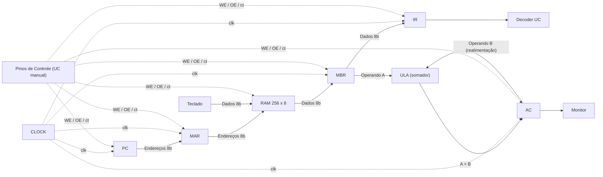
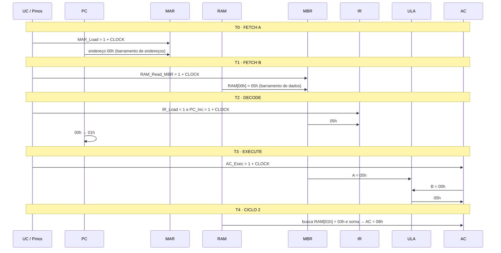

# Simulador Interativo da CPU NeoCore (8 bits) — Guia Técnico e Didático

> **Projeto:** Simulação e Análise de Arquitetura Interna de um Computador
> **Instituição:** Centro Universitário UniFECAF — *Computer Architecture and Organization*
> **Autor:** João Pedro Vieira da Costa Chaves
> **Cenário:** Prova de Conceito (PoC) para a empresa fictícia educacional **NeoCore Tech**
> **Arquivo do simulador:** [`index.html`](../index.html) · **Circuito de origem:** [`src/neocore_cpu.circ`](../src/neocore_cpu.circ) (Logisim-Evolution v5.0.0)

---

## Sumário

1. [Visão geral do projeto](#1-visão-geral-do-projeto)
2. [O que é o simulador interativo](#2-o-que-é-o-simulador-interativo)
3. [Arquitetura modelada](#3-arquitetura-modelada)
4. [Elementos do circuito](#4-elementos-do-circuito)
5. [Barramentos e convenção de cores](#5-barramentos-e-convenção-de-cores)
6. [Modelo de execução (semântica do clock)](#6-modelo-de-execução-semântica-do-clock)
7. [Passos produzidos pela simulação guiada (T0–T4)](#7-passos-produzidos-pela-simulação-guiada-t0t4)
8. [Interface do simulador](#8-interface-do-simulador)
9. [Roteiro didático: primeiros passos](#9-roteiro-didático-primeiros-passos)
10. [Atividades sugeridas](#10-atividades-sugeridas)
11. [Relação com LOAD, ADD e STORE](#11-relação-com-load-add-e-store)
12. [Simplificações e limitações do modelo](#12-simplificações-e-limitações-do-modelo)
13. [Execução, compatibilidade e publicação](#13-execução-compatibilidade-e-publicação)
14. [Referências](#14-referências)

---

## 1. Visão geral do projeto

O projeto procura responder à pergunta norteadora:

> *Como os diferentes componentes de um computador trabalham de forma coordenada para buscar, interpretar e executar uma instrução?*

Para isso, foi modelada no **Logisim-Evolution** uma CPU didática de 8 bits baseada na **arquitetura de Von Neumann**, em que instruções e dados compartilham a mesma memória principal e trafegam pelos mesmos barramentos. Sobre esse circuito foi construído um **simulador web interativo** ([`index.html`](../index.html)) que reproduz o esquemático com as mesmas coordenadas do arquivo exportado [`src/main_board.svg`](../src/main_board.svg). Assim, o ciclo de instrução pode ser demonstrado em qualquer navegador, sem instalar o Logisim.

| Entregável | Peso | Onde está |
| :--- | :---: | :--- |
| Parte Teórica (relatório) | 25% | `docs/` e `dist/` |
| Parte Prática (simulação) | 50% | `src/neocore_cpu.circ` e `index.html` |
| Vídeo Pitch (≤ 4 min) | 25% | `docs/pitch/pitch_script.md` |

---

## 2. O que é o simulador interativo

O [`index.html`](../index.html) é um arquivo único (HTML, CSS e JavaScript, sem dependências externas além das fontes Roboto). Ele contém:

- **Esquemático vetorial (SVG)** com reprodução 1:1 do circuito `main_board` exportado do Logisim-Evolution: canvas de `1151 × 441` unidades e grade pontilhada de 10 × 10.
- **Motor de simulação síncrono**: os registradores só são atualizados na **borda de subida do clock** e apenas quando o sinal de habilitação correspondente está em nível lógico `1`.
- **Sequência guiada de micro-operações** (`T0` a `T4`) que percorre as fases de **Busca → Decodificação → Execução**.
- **Explicações contextuais**: tocar em qualquer componente ou barramento exibe sua função, entradas, saídas e fase do ciclo no card de contexto.
- **Interface em Material Design 3 (tema escuro)**, com barra flutuante de controles, zoom, arraste e painéis de inspeção.

O objetivo pedagógico é tornar **visível** o que normalmente é abstrato: qual registrador é escrito, por qual barramento o dado passa e qual sinal de controle autoriza cada transferência.

---

## 3. Arquitetura modelada

### 3.1 Diagrama de blocos (caminho de dados)



### 3.2 Correspondência com os subsistemas de Von Neumann

| Subsistema | Representação no simulador |
| :--- | :--- |
| **CPU — Unidade de Controle** | Pinos de controle (`MAR_Load`, `RAM_Read_MBR`, `IR_Load`, `PC_Inc`, `AC_Exec`) + bloco `Decoder UC` |
| **CPU — Caminho de dados** | Registradores `PC`, `MAR`, `MBR`, `IR`, `AC` e a `ULA` |
| **Memória principal** | `RAM 256 × 8` (instruções e dados no mesmo espaço) |
| **Barramento do sistema** | Barramentos de controle, endereços e dados |
| **E/S** | `Teclado` (entrada) e `Monitor` (saída) |

---

## 4. Elementos do circuito

### 4.1 Registradores

| Elemento | Largura | Entradas | Saída | Sinal de habilitação | Papel |
| :--- | :---: | :--- | :--- | :--- | :--- |
| **PC** (*Program Counter*) | 8 bits | `clk`, `ct` | `Q` → `MAR.D` | `PC_Inc` | Guarda o endereço da próxima instrução; é incrementado após a busca. |
| **MAR** (*Memory Address Register*) | 8 bits | `D` (do PC), `WE`, `clk` | `Q` → `RAM.A` | `MAR_Load` | Apresenta o endereço à memória pelo barramento de endereços. |
| **MBR** (*Memory Buffer Register*) | 8 bits | `D` (da RAM), `WE`, `clk` | `Q` → `IR` e `ULA` | `RAM_Read_MBR` | Retém o byte lido da memória e o distribui internamente. |
| **IR** (*Instruction Register*) | 8 bits | `D` (do MBR), `WE`, `clk` | `Q` → `Decoder UC` | `IR_Load` | Armazena a instrução buscada para decodificação. |
| **AC** (*Accumulator*) | 8 bits | `D` (da ULA), `WE`, `clk` | `Q` → `Monitor` e `ULA` | `AC_Exec` | Registrador de trabalho que guarda resultados da ULA. |

Os valores de `MAR`, `IR`, `MBR` e `AC` aparecem em hexadecimal na caixa cinza acima de cada registrador, como no Logisim. O `PC` exibe seu valor dentro do próprio bloco.

### 4.2 Unidades funcionais, memória e E/S

| Elemento | Descrição |
| :--- | :--- |
| **ULA** | Somador de 8 bits. Entrada A ← `MBR`; entrada B ← `AC` (realimentação). A saída `A + B` alimenta `AC.D`. O resultado é truncado em 8 bits (módulo 256). |
| **Decoder UC** | Bloco que exibe a interpretação do conteúdo do `IR`: `NOP (00h)` quando o `IR` vale `00h` e `ADD/LOAD XXh` nos demais casos. Representa conceitualmente a tradução CISC → micro-operações RISC. |
| **RAM 256 × 8** | Memória principal. No painel interno, a célula apontada pelo `MAR` fica destacada em fundo escuro. Programa de teste padrão: `00h = 05h`, `01h = 03h`, `02h = 0Ah`, `03h = 00h`. |
| **Teclado** | Pino de entrada de 8 bits (padrão `00000101` = `05h`). Ao clicar, grava seu valor em `RAM[MAR]`. |
| **Monitor** | Pino de saída de 8 bits que exibe em binário o valor atual do `AC`. |
| **CLOCK** | Fonte de sincronização. Cada clique gera uma borda de subida e a rede de clock pisca em verde claro. |

### 4.3 Pinos de controle (barramento de controle)

| Pino | Destino no circuito | Micro-operação habilitada (na borda do clock) |
| :--- | :--- | :--- |
| `MAR_Load` | `WE` do MAR | `MAR ← PC` |
| `RAM_Read_MBR` | `OE` da RAM e `WE` do MBR | `MBR ← RAM[MAR]` |
| `IR_Load` | `WE` do IR | `IR ← MBR` |
| `PC_Inc` | `ct` do PC | `PC ← PC + 1` |
| `AC_Exec` | `WE` do AC | `AC ← AC + MBR` |

---

## 5. Barramentos e convenção de cores

| Barramento | Largura | Direção | Trajeto no esquemático | Cor |
| :--- | :---: | :--- | :--- | :--- |
| **Clock** | 1 bit | CLOCK → registradores | `CLOCK → clk` de PC, MAR, MBR, IR e AC | Verde escuro; pisca em verde claro a cada pulso |
| **Controle** | 1 bit por sinal | UC → componentes | Pinos de controle → `WE` / `OE` / `ct` | Verde escuro (`0`) / verde claro (`1`) |
| **Endereços** | 8 bits | Unidirecional (CPU → memória) | `PC → MAR → RAM.A` | Preto espesso |
| **Dados** | 8 bits | Entre memória, registradores e ULA | `RAM → MBR → IR / ULA → AC → Monitor`; `Teclado → RAM` | Preto espesso |

A convenção de verdes segue o Logisim-Evolution: **verde claro = nível lógico `1`** e **verde escuro = nível lógico `0`**. Os botões de filtro na barra superior (`Todos`, `Clock`, `Controle (WE/OE)`, `Endereços (8b)`, `Dados / ULA (8b)`) esmaecem as demais camadas para isolar um barramento.

---

## 6. Modelo de execução (semântica do clock)

O motor reproduz o comportamento de **registradores sensíveis à borda de subida**. A cada pulso de clock:

1. **Captura**: os valores atuais de `PC`, `MAR`, `MBR` e `AC` são lidos *antes* de qualquer escrita.
2. **Atualização**: cada registrador com o sinal de habilitação em `1` recebe o novo valor, calculado a partir dos valores capturados.

```text
se MAR_Load     = 1  →  MAR ← PC(anterior)
se RAM_Read_MBR = 1  →  MBR ← RAM[MAR(anterior)]
se IR_Load      = 1  →  IR  ← MBR(anterior)
se PC_Inc       = 1  →  PC  ← PC(anterior) + 1
se AC_Exec      = 1  →  AC  ← AC(anterior) + MBR(anterior)
```

Com isso, várias micro-operações podem ocorrer **no mesmo pulso** sem interferir entre si. É o caso de `T2`, em que `IR ← MBR` e `PC ← PC + 1` acontecem simultaneamente, exatamente como em hardware síncrono real.

> [!IMPORTANT]
> Ligar um pino de controle **não** altera nenhum registrador. A transferência só acontece quando o **CLOCK** é pulsado. Essa é a principal ideia a ser fixada pelo aluno: *sinais de controle autorizam, o clock executa*.

---

## 7. Passos produzidos pela simulação guiada (T0–T4)

O botão **Próximo Passo** executa a sequência abaixo. Em `T0`–`T3`, o simulador configura os pinos de controle e dispara um pulso de clock. `T4` resume um segundo ciclo completo de uma só vez.

### 7.1 Visão temporal



### 7.2 Sinais de controle por passo

| Passo | Fase | Micro-operação (RTL) | `MAR_Load` | `RAM_Read_MBR` | `IR_Load` | `PC_Inc` | `AC_Exec` |
| :---: | :--- | :--- | :---: | :---: | :---: | :---: | :---: |
| **T0** | Busca A | `MAR ← PC` | **1** | 0 | 0 | 0 | 0 |
| **T1** | Busca B | `MBR ← RAM[MAR]` | 0 | **1** | 0 | 0 | 0 |
| **T2** | Decodificação | `IR ← MBR`; `PC ← PC + 1` | 0 | 0 | **1** | **1** | 0 |
| **T3** | Execução | `AC ← AC + MBR` | 0 | 0 | 0 | 0 | **1** |
| **T4** | 2º ciclo (resumido) | `MAR ← 01h`; `MBR ← RAM[01h]`; `IR ← MBR`; `PC ← 02h`; `AC ← RAM[00h] + RAM[01h]` | 0 | 0 | 0 | 0 | **1** |

### 7.3 Estado dos registradores após cada passo (programa padrão)

Valores partindo do estado de reset, com `RAM = [05h, 03h, 0Ah, 00h]`:

| Após | PC | MAR | MBR | IR | AC | Monitor | Decoder UC |
| :---: | :---: | :---: | :---: | :---: | :---: | :---: | :--- |
| Reset | 00h | 00h | 00h | 00h | 00h | `00000000` | `NOP (00h)` |
| **T0** | 00h | 00h | 00h | 00h | 00h | `00000000` | `NOP (00h)` |
| **T1** | 00h | 00h | **05h** | 00h | 00h | `00000000` | `NOP (00h)` |
| **T2** | **01h** | 00h | 05h | **05h** | 00h | `00000000` | `ADD/LOAD 05h` |
| **T3** | 01h | 00h | 05h | 05h | **05h** | `00000101` | `ADD/LOAD 05h` |
| **T4** | **02h** | **01h** | **03h** | **03h** | **08h** | `00001000` | `ADD/LOAD 03h` |

> [!NOTE]
> Em `T0` o `MAR` recebe `00h`, que já era seu valor após o reset. A mudança não é numérica, mas o fio `MAR_Load` acende e a célula `00h` da RAM fica selecionada. Para tornar a transferência visível, edite a RAM ou execute um segundo ciclo (ver [Atividade 3](#10-atividades-sugeridas)).

### 7.4 Comportamento contínuo (Auto-Clock)

O botão **Auto-Clock (1 Hz)** executa um passo guiado a cada ~1,1 s. Ao terminar `T4`, a sequência volta para `T0` **sem resetar os registradores**. Por isso, o segundo giro continua a partir do estado atual: por exemplo, `MAR ← 02h` e `MBR ← RAM[02h] = 0Ah`. Para demonstrações, recomenda-se clicar em **Resetar CPU** antes de iniciar.

---

## 8. Interface do simulador

### 8.1 Mapa da tela

| Região | Conteúdo |
| :--- | :--- |
| **Barra superior** | Título, filtros de barramento e botão **Baixar neocore_cpu.circ**. |
| **Canvas** | Esquemático interativo ocupando toda a área útil (arrastar e zoom). |
| **Card de contexto** (inferior esquerdo) | Explicação do passo atual do ciclo **ou** do componente tocado, com barra de progresso azul. |
| **Barra flutuante (dock)** | Linha superior: `Painéis`, `Modo Explicação`, `Ajustar` e zoom (`−` / `%` / `+`). Linha inferior: chip da etapa (ex.: `T0 · FETCH A`), `Próximo Passo`, `Auto-Clock (1 Hz)`, `Pulso Manual de Clock`, `Resetar CPU`. O botão de seta minimiza a linha de execução. |
| **Painéis** (gaveta lateral) | Lista do ciclo `T0`–`T4` (clique para saltar), tabela de registradores (Hex, Binário, Decimal, sinal de controle), saída prevista da ULA, edição da RAM `00h`–`03h` e do Teclado. |

### 8.2 Interações no canvas

| Ação | Resultado |
| :--- | :--- |
| Clicar em `PC`, `MAR`, `MBR`, `IR`, `Decoder UC`, `RAM`, `ULA`, `AC`, `Monitor` ou em um barramento | O elemento recebe destaque azul e sua ficha técnica aparece no card de contexto (tipo, descrição, entradas/saídas, fase e, nos registradores, o valor atual). |
| Clicar em um pino de controle | Alterna o nível lógico (`0` ↔ `1`) e exibe a explicação do pino. |
| Clicar no **CLOCK** | Gera um pulso: aplica as micro-operações habilitadas. |
| Clicar no **Teclado** | Grava o valor do teclado em `RAM[MAR]`. |
| **Modo Explicação** ativo | Pinos, CLOCK e Teclado passam a apenas explicar, sem alterar o circuito. |
| Arrastar / roda do mouse / pinça | Move e aproxima o circuito (25% a 600%), mantendo o vetor nítido. |

### 8.3 Telas pequenas

Em telas com largura ≤ 767 px (ou altura ≤ 450 px com largura ≤ 950 px), a área de trabalho é insuficiente. O simulador exibe então um **aviso em tela cheia**, sem rolagem e com a aplicação inativa ao fundo. O aviso oferece dois botões: **Baixar o circuito** e **Exibir QR Code**, este para abrir o simulador em um tablet ou computador.

---

## 9. Roteiro didático: primeiros passos

Sequência recomendada para a primeira utilização (aula, monitoria ou gravação do pitch).

### Etapa 1 — Reconhecer o circuito (≈ 2 min)

1. Abra o [`index.html`](../index.html) em um navegador de desktop ou tablet e clique em **Ajustar**.
2. Ative **Modo Explicação** e toque, nesta ordem, em: `PC` → `MAR` → `RAM` → `MBR` → `IR` → `Decoder UC` → `ULA` → `AC` → `Monitor`. Leia a ficha de cada um no card de contexto.
3. Use os filtros **Endereços (8b)** e **Dados / ULA (8b)** para visualizar separadamente cada barramento. Volte para **Todos**.
4. Desative o **Modo Explicação**.

### Etapa 2 — Executar o ciclo guiado (≈ 3 min)

1. Clique em **Resetar CPU** e abra **Painéis** para acompanhar a tabela de registradores.
2. Clique em **Próximo Passo** cinco vezes, observando a cada passo:
   - qual pino de controle acende (verde claro);
   - qual registrador muda de valor;
   - qual barramento transporta a informação;
   - o texto explicativo e o avanço da barra azul no card de contexto.
3. Ao final, confira: `AC = 08h` e Monitor `00001000` (5 + 3 = 8).

### Etapa 3 — Operar manualmente como a Unidade de Controle (≈ 4 min)

Reproduza `T0`–`T3` **sem** o botão Próximo Passo, assumindo o papel da UC:

| Passo | Ação manual |
| :---: | :--- |
| 1 | **Resetar CPU**. Ligue `MAR_Load` → clique no **CLOCK** → desligue `MAR_Load`. |
| 2 | Ligue `RAM_Read_MBR` → **CLOCK** → desligue. Verifique `MBR = 05h`. |
| 3 | Ligue `IR_Load` **e** `PC_Inc` → **CLOCK** → desligue ambos. Verifique `IR = 05h` e `PC = 01h`. |
| 4 | Ligue `AC_Exec` → **CLOCK** → desligue. Verifique `AC = 05h`. |

> [!TIP]
> Esquecer de desligar um pino é um ótimo erro didático. Se `AC_Exec` permanecer em `1`, cada novo pulso soma o `MBR` ao `AC` outra vez (05h → 0Ah → 0Fh…). Isso evidencia por que a UC precisa **desativar** sinais ao fim de cada micro-operação.

### Etapa 4 — Consolidar (≈ 1 min)

Peça ao aluno que relacione cada passo à fase do ciclo e ao barramento usado, preenchendo a tabela da [Seção 7.2](#72-sinais-de-controle-por-passo) sem consultá-la.

---

## 10. Atividades sugeridas

| # | Atividade | Objetivo de aprendizagem |
| :---: | :--- | :--- |
| 1 | Em **Painéis**, altere `RAM[00h]` para `0Ah` e `RAM[01h]` para `14h`; execute `T0`–`T4`. Qual o valor final do `AC`? (Resposta: `1Eh` = 30.) | Relacionar o conteúdo da memória ao resultado. |
| 2 | Coloque `RAM[00h] = FFh` e `RAM[01h] = 02h`. Qual o resultado? (Resposta: `01h`, pois a soma é truncada em 8 bits.) | Introduzir *overflow* e aritmética módulo 2⁸. |
| 3 | Após `T4`, continue clicando em **Próximo Passo** e explique por que o `MAR` passa a valer `02h`. | Compreender o papel do `PC` no sequenciamento. |
| 4 | Pulse o CLOCK com **todos** os pinos em `1` a partir do reset e explique cada valor resultante com base na [Seção 6](#6-modelo-de-execução-semântica-do-clock). | Entender a captura simultânea na borda de subida. |
| 5 | Defina `Teclado = 2Ah`, leve `MAR` a `02h` (via `PC`) e clique no Teclado. Confirme a escrita em `RAM[02h]`. | Ilustrar E/S mapeada para a memória. |
| 6 | Use o filtro **Controle (WE/OE)** e descreva o trajeto de `RAM_Read_MBR` até a RAM e o MBR. | Mostrar que um único sinal pode controlar dois componentes. |

---

## 11. Relação com LOAD, ADD e STORE

O simulador demonstra o **caminho de dados** e a **sequência temporal** do ciclo. Nas instruções clássicas de máquinas de acumulador (Stallings), o formato `OPCODE [endereço]` exige ciclos extras de busca de operando. A tabela compara a sequência canônica com o que o simulador executa.

| Instrução | Sequência canônica (RTL) | Representação no simulador |
| :--- | :--- | :--- |
| **Busca (comum a todas)** | `T0: MAR ← PC` · `T1: MBR ← M[MAR]` · `T2: IR ← MBR; PC ← PC + 1` | Implementada fielmente em `T0`–`T2`. |
| **LOAD [addr]** | `T3: MAR ← IR(addr)` · `T4: MBR ← M[MAR]` · `T5: AC ← MBR` | Aproximada: com `AC = 00h`, `T3` produz `AC ← 0 + MBR`, equivalente a carregar o `MBR` no `AC`. |
| **ADD [addr]** | `T3: MAR ← IR(addr)` · `T4: MBR ← M[MAR]` · `T5: AC ← AC + MBR` | Representada em `T3`/`T4`: a ULA soma `AC + MBR` e o resultado volta ao `AC`. |
| **STORE [addr]** | `T3: MAR ← IR(addr)` · `T4: MBR ← AC` · `T5: M[MAR] ← MBR` | **Não implementada** como micro-operação: não há sinal `MEM_WRITE` nem caminho `AC → MBR → RAM`. A única escrita em memória disponível é `RAM[MAR] ← Teclado`. |

---

## 12. Simplificações e limitações do modelo

Para fins didáticos, o modelo adota as seguintes simplificações, que devem ser explicitadas no relatório e no pitch:

1. **UC manual / sequenciada:** os sinais de controle são acionados pelo usuário ou pela sequência guiada. O `Decoder UC` apenas **exibe** uma interpretação do `IR` e não gera os sinais a partir do opcode.
2. **Sem separação opcode/operando:** o byte buscado (`05h`) é carregado no `IR` e também usado como operando da ULA via `MBR`. Não há campo de endereço no `IR` nem o passo `MAR ← IR(addr)`.
3. **Memória efetiva de 4 posições:** embora a RAM seja `256 × 8`, o simulador web usa `MAR mod 4`, ou seja, as células `00h`–`03h`. As demais aparecem fixas em `00h` no painel.
4. **T4 resumido:** o segundo ciclo é aplicado em uma única etapa (`AC ← RAM[00h] + RAM[01h]`), sem mostrar os pulsos intermediários.
5. **ULA apenas soma:** não há subtração, operações lógicas nem flags (*carry*, *zero*, *overflow*). O estouro é descartado.
6. **Sem STORE:** não existe escrita `AC → memória` (ver Seção 11).

Esses pontos são oportunidades para trabalhos futuros: uma UC com contador de tempo e decodificador real, formato de instrução `[opcode | endereço]`, sinal `MEM_WRITE` e ULA com seleção de operação e flags.

---

## 13. Execução, compatibilidade e publicação

| Item | Detalhe |
| :--- | :--- |
| **Como abrir** | Abrir `index.html` diretamente no navegador ou servi-lo por HTTP (ex.: GitHub Pages). |
| **Navegadores** | Versões recentes de Chrome, Edge, Firefox e Safari (usa `<dialog>`-free UI, `inert`, `dvh`, `backdrop-filter`). |
| **Tamanho mínimo** | Largura ≥ 768 px (tablets e desktops). Em telas menores aparece o aviso em tela cheia. |
| **Download do circuito** | O botão tenta `./src/neocore_cpu.circ` e depois a versão *raw* no GitHub. Se ambos falharem (por exemplo, ao abrir via `file://` sem internet), abre o link do GitHub em nova aba. |
| **QR Code** | Gerado localmente (sem serviço externo) com a URL da página quando servida por HTTP(S); caso contrário, usa a URL do repositório. |
| **Arquivo Logisim** | [`src/neocore_cpu.circ`](../src/neocore_cpu.circ), compatível com Logisim-Evolution v5.0.0. |

---

## 14. Referências

STALLINGS, William. **Arquitetura e organização de computadores**. 10. ed. São Paulo: Pearson, 2017.

TANENBAUM, Andrew S.; AUSTIN, Todd. **Organização estruturada de computadores**. 6. ed. São Paulo: Pearson, 2013.

LOGISIM-EVOLUTION. **Logisim-evolution: digital logic design tool and simulator**. Versão 5.0.0. Disponível em: https://github.com/logisim-evolution/logisim-evolution. Acesso em: 1 nov. 2026.

